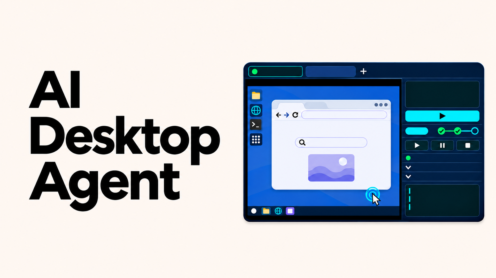

# AI Desktop Agent



自然言語の指示で、AIがVMやコンテナ内のデスクトップを操作する。ブラウザで画面を見ながら、指示を送り、実行を一時停止・停止し、履歴を確認できる。

## 起動する

Docker Engine（API 1.48以降）、Docker Compose 2.34.0以降、画像入力に対応するLLMが必要になる。アプリはローカルでの1人利用を想定している。操作画面とAPIはホスト内から接続し、インターネットには公開しない。

1. リポジトリを取得し、設定ファイルを用意する。

   ```bash
   git clone https://github.com/Milix-M/ai-desktop-agent.git
   cd ai-desktop-agent
   (umask 077; cp -n .env.example .env)
   realpath .env
   ```
2. `.env` に `LLM_PROVIDER` と、必要な場合は対応するAPIキーを設定する。利用できる提供元は[LLMを選ぶ](#llmを選ぶ)を参照する。
3. リポジトリのルートで起動する。

   ```bash
   ./scripts/up.sh
   ```
4. 次のコマンドで接続キーを確認し、[操作画面](http://localhost:3000)に入力する。`.env` に `AGENT_ACCESS_TOKEN` を設定した場合は、その値を使う。

   ```bash
   docker compose exec backend cat /app/data/auth/access-key
   ```

既定では、x86_64ホストに `/dev/kvm` とVMテンプレートが揃っていればQEMU VM、それ以外はXfceコンテナが起動する。QEMU VMを用意するには、手順3の前に `sudo ./vm/build-vm-image.sh` を実行する。このスクリプトはホストにパッケージを導入し、`vm/desktop.qcow2` を作成する。`USE_KVM=false` でコンテナを選べる。`USE_KVM=true` のときは条件が揃わなければ起動を止める。[Androidは別途準備する](android/README.md)。

## Cua Driver でウィンドウやボタンを選ぶ

Xfce コンテナ（Linux arm64・x86_64）では、エージェントがウィンドウ名でアプリを切り替え、ボタンやメニューを名前でクリックできる。有効にすると、モデルには画面とともにウィンドウ名と操作できる要素のラベルが送られる。描画領域など、名前で選べない箇所では VNC を使う。

1. `.env` に `USE_KVM=false` と `CUA_DRIVER_ENABLED=true` を設定し、`./scripts/up.sh` を実行する。ハイブリッド用のデスクトップイメージには、Calc の保存ボタンなどを読み取るための LibreOffice GTK 連携も入る。
2. 次のコマンドで既定のデスクトップに Driver を導入する。追加の Xfce コンテナでは、対象コンテナに対して `docker exec --user agent <コンテナ名> install-cua-driver` を実行する。

   ```bash
   docker compose exec --user agent desktop install-cua-driver
   ```

3. 操作画面で新しいタスクを開始する。たとえば Mousepad とファイルマネージャーを開き、「Mousepad に切り替えて、この文書を『作業メモ.txt』として保存して」と指示する。操作履歴の `focus_window` がウィンドウ切替、`element_click` が要素のクリックに対応する。

Calc で入力先が決まっている場合は、「B2 に数量、C2 に単価、D2 に積の数式を入れて保存して」のように番地を指定できる。操作履歴の `calc_write` は、開いているシートに最大32セルをまとめて入力し、セルごとに内容を照合する。数式の表示値は番地とともに記録し、ほかのアプリへの転記に使う。数式の結果が空欄で読み取れない場合も、その番地で止まる。途中で止まった場合は、履歴に表示された番地から確認する。同じ操作で既存ファイルを保存した場合は、履歴の `save` が `true` になり、Ctrl+S を送信した後も同じ文書が前面にあることを確認する。保存ダイアログが開いたときは次の画面で操作を続ける。

導入時に GitHub の公式リリースから 0.54.0 を取得し、配布ファイルの SHA-256 を照合する。実行ファイルとライセンスは対象環境の `~/.local/share/ai-desktop-agent/` に保存する。接続できない場合はそのタスクを VNC で続ける。原因を調べるには `docker compose logs backend` を確認する。VNC のみに戻すには `CUA_DRIVER_ENABLED=false` に変更して `./scripts/up.sh` を実行する。QEMU と Android は VNC を使う。

Cua Driver 本体は MIT ライセンス。上記の導入対象は Driver の Linux 実行ファイルで、画像認識拡張やモデルは含まない。第三者へ実行ファイルを渡す場合は著作権表示と許諾文を添付し、依存部品の個別条件も確認する。[同梱のライセンス原文](desktop/licenses/Cua-Driver-MIT.txt)・[上流のライセンスの適用範囲](https://github.com/trycua/cua/blob/cua-driver-rs-v0.54.0/legal/LICENSING.md)・[公式リリース](https://github.com/trycua/cua/releases/tag/cua-driver-rs-v0.54.0)

### 複数の表を照合して保存する

上の手順で Cua Driver を有効にし、Firefox に元資料、Calc に出力先のシート、Mousepad に報告書を開く。「製品表と入出庫表を SKU で照合し、確定分だけ合計してシートに保存。補充が必要な SKU と数量を報告書に保存」のように、照合キー・条件・出力先を指示する。

Firefox が表として公開しているデータは、そのページを開いたときにタスク内で保持する。操作履歴の `table_query` は取得した表の抽出・結合・集計、`table_fill` は結果を Calc に記入する操作、`table_type` は結果を Mousepad に転記する操作。Calc で保存を指定すると、最大32セルごとに内容を照合して保存する。表の取得は見出しを含めて256行、32列、2,048セルまで。タスクを終了すると取得した表のメモリは解放される。

OpenAI の利用費を抑えるには、`.env.example` の「低コスト設定例」を `.env` に適用して起動する。この例では Luna を使用し、1タスクの推定費用が $0.05 に達した時点で停止する。費用は応答ごとに集計するため、最後の応答で設定額を超える場合がある。

### 文章を読み合わせて引き継ぎ文を作る

Firefox で資料を開き、読み比べる項目と保存先を指示する。たとえば「4件の議事録を読み、各議題の最終決定・担当者・期限を引き継ぎ文にまとめて保存」。読み取った段落はタスク内で保持する。エージェントは別のアプリに移ったあとも資料を検索できる。

### フォルダーの中のファイルをまとめて仕分けする

Cua Driver を有効にしたコンテナで、資料と仕分け先を一つのフォルダーに入れる。［ファイルの一括操作］を開き、対象フォルダーを Documents からの相対パスで指定する。たとえば対象が `/home/agent/Documents/April` なら `April` と入力する。「規程を読み、受付記録を対応中・完了に移し、未対応の担当者を引き継ぎ文に保存」のように指示して［実行］を選ぶ。

指定したフォルダーでは、UTF-8 の文章の読み取りとファイルの移動を1回につき24件までまとめて実行する。画面の操作履歴で一括操作を確認できる。読込は1回あたり合計24,000バイトまで。一覧には対象フォルダーから5階層目までのファイルとフォルダーを合わせて256件まで表示する。件数が上限を超える場合は、作業単位でフォルダーを分ける。1 MiB 以下の移動ファイルは、完了確認時に原文との一致も照合する。移動先に同名のファイルがあれば、その時点で一括移動を打ち切り、移動済みのファイルは移動先に残る。フォルダーを空欄にすると一括ファイル操作は無効になる。API の `POST /tasks` と MCP の `start_desktop_task` では同じ相対パスを `workspace` に指定する。

## 指示を出す

環境のタブを選び、指示を入力して［実行］を選ぶ。Enterで送信し、Shift+Enterで改行する。日本語変換中のEnterでは送信しない。［準備中］［接続異常］の環境には指示を送れない。

同じ環境で次の指示を実行すると、先に実行していたタスクが止まる。［手動入力待ち］の間は新しい指示を受け付けない。別の環境では並行して実行できる。ログアウト後もタスクは続く。終了させるには、先に［停止］を選ぶ。

通信エラーで受付結果が分からないときは、同じ指示・環境・再起動許可で［再送］を選ぶ。受付済みなら同じタスクの状態を返す。混雑時は画面に表示された秒数を待ってから再送する。履歴の削除後にやり直すときは［新しいタスクとして実行］を選ぶ。

パスワードや認証コードを使うときは、指示に値を書かず、AIに手動入力を求めるよう指示する。［手動入力待ち］になったら接続先を確認してデスクトップへ直接入力し、秘密情報を画面から隠して［画面を送信して再開］を選ぶ。[画面送信と履歴の扱い](docs/safety.md#秘密情報を入力する)を参照する。

［VM再起動を許可する］を選ぶと、AIが作業環境を再起動できる。再起動後もディスクは保持する。動的環境の削除ではディスクやホーム用ボリュームも消えるため、必要なファイルを先に保存する。

## タスクを予約する

［スケジュール］の［実行環境］で、選択中の環境か、毎回新しく作る環境のタイプ（コンテナ・QEMU VM・Android）を選ぶ。使い捨ての場合は、環境を事前に作成する必要はない。指示と開始日時を入力し、［1回のみ］［24時間ごと］［7日ごと］から選んで［予約する］を押す。開始日時はブラウザのタイムゾーンで指定する。予約を取り消すには、一覧で［予約を削除］を選ぶ。

使い捨ての場合は、予約時刻に環境を作成し、起動が終わるとタスクを開始する。作成後10分たっても起動準備中の場合は、その回を失敗として環境を削除する。手動入力待ちや一時停止中は環境を保持する。完了・失敗・停止後は環境内のファイルも削除するため、必要な値は指示で実行結果として返すよう指定する。結果は環境の削除後もタスク履歴で確認できる。

ブラウザを閉じてもバックエンドが起動していれば予約を実行する。対象の環境で別のタスクを実行中の場合は、その回を見送り、予約一覧に理由を表示する。バックエンドの停止中に実行時刻を過ぎた予約は、次の起動時に1回だけ実行する。繰り返し予約は元の開始日時を基準に続く。

## 日本語を入力する

更新済みの固定desktopと、更新後に追加したコンテナで日本語や絵文字を入力できる。QEMU・AndroidのUnicode入力は未対応となる。貼り付け時は作業環境のクリップボードを置き換え、1回につきUTF-8で64 KiBまで送る。改行やタブも文字として貼り付けるため、端末では貼り付け後にEnterで実行する。

文字の選択がクリップボード更新で解除される場合がある。選択した文字を置き換えるときは、Backspaceで削除してから入力する。貼り付けが失敗した場合は、デスクトップで入力結果を確認してから次の指示を出す。

## LLMを選ぶ

`.env` の `LLM_PROVIDER`、`LLM_MODEL`、対応するキーで切り替える。モデルは画像入力に対応するものを選ぶ。

| `LLM_PROVIDER` | キー |
| --- | --- |
| `openai` | `OPENAI_API_KEY` |
| `anthropic` | `ANTHROPIC_API_KEY` |
| `openrouter` | `OPENROUTER_API_KEY` |
| `opencode` | `OPENCODE_API_KEY` |
| `opencode-go` | `OPENCODE_GO_API_KEY` |
| `ollama` | 不要 |

OpenAIでGPT-5.4を使う場合は、`.env` に `LLM_PROVIDER=openai`、`LLM_MODEL=gpt-5.4`、`OPENAI_API_KEY` を設定する。実機検証ではサブタスクごとの待ち時間を `TASK_SUBTASK_TIMEOUT_SECONDS=180` に設定した。

Ollamaを使う場合は、Ollamaを動かす環境で `ollama pull qwen2.5vl:3b` を実行し、アプリの `.env` に `LLM_PROVIDER=ollama` を設定する。別の画像対応モデルを使う場合は、取得したモデル名を `LLM_MODEL` に指定する。

`OLLAMA_BASE_URL` には、バックエンドから接続できるOllamaのURLを `/v1` まで指定する。たとえば同じCompose管理ネットワークに `ollama` というサービスがある場合は `http://ollama:11434/v1` を使う。省略時の `http://localhost:11434/v1` はバックエンド自身を指す。

## 実行上限を変える

次の上限は `.env` に正数で指定する。

| 設定 | 既定の上限 |
| --- | --- |
| `TASK_MAX_SECONDS` | 1800秒 |
| `TASK_REQUEST_TIMEOUT_SECONDS` | 1送信の応答待ち120秒 |
| `TASK_SUBTASK_TIMEOUT_SECONDS` | サブタスクごとに60秒 |
| `TASK_MAX_REQUESTS` | 500送信 |
| `TASK_MAX_TOKENS` | 入出力合計100000トークン |

推定費用を制限するには、`TASK_MAX_COST_USD` と、入出力それぞれ100万トークン当たりのUSD単価 `TASK_INPUT_USD_PER_MILLION`、`TASK_OUTPUT_USD_PER_MILLION` を指定する。複数のモデルを使う場合は、使用する各モデルの単価を下回らない値を指定する。使用量は応答後に加算するため、トークンと推定費用は1送信分超過する場合がある。推定費用と実際の請求額は異なる場合がある。[上限に達した場合の挙動](docs/safety.md#実行と停止)を参照する。

## 更新する

アプリ内の作業を保存してから `./scripts/up.sh` を実行する。更新中はバックエンドと選択した固定環境を停止する。固定desktopでは `/home/agent` をバックアップし、旧コンテナのホームを専用ボリュームへ移す。`docker compose up` を直接実行すると、この移行処理は走らない。[バックアップの対象と復元手順](docs/workspace-backups.md)を参照する。

## コンテナデスクトップをgVisorで動かす

[gVisorのDocker設定手順](https://gvisor.dev/docs/user_guide/quick_start/docker/)に従い、Dockerホストに `runsc` を登録する。作業を保存してから、`.env` に `DESKTOP_RUNTIME=runsc` を設定して `./scripts/up.sh` を実行する。固定環境をコンテナにする場合は `USE_KVM=false` も設定する。

設定は固定desktopの再作成時と、追加コンテナの作成時に適用する。作成済みの追加環境は作成時のランタイムで動く。省略時はDockerホストの既定を使い、標準ランタイムを明示するには `DESKTOP_RUNTIME=runc` を指定する。未登録の `runsc` を指定すると、起動や追加作成を止める。管理バックエンドは引き続きDockerソケットを使う。

## 詳細

- [安全性と利用範囲](docs/safety.md)
- [デスクトップのホームを保存・復元する](docs/workspace-backups.md)
- [MCP・Webhookでタスク結果を受け取る](docs/task-integrations.md)
- [構成・API・データの保存先](docs/architecture.md)
- [テストとCI](docs/testing.md)
- [定型作業を評価する](docs/desktop-evaluation.md)
- [本番利用に向けた確認事項](docs/production-readiness.md)
- [決定モデルの評価](docs/research/clef.md)

ライセンスはMIT。
