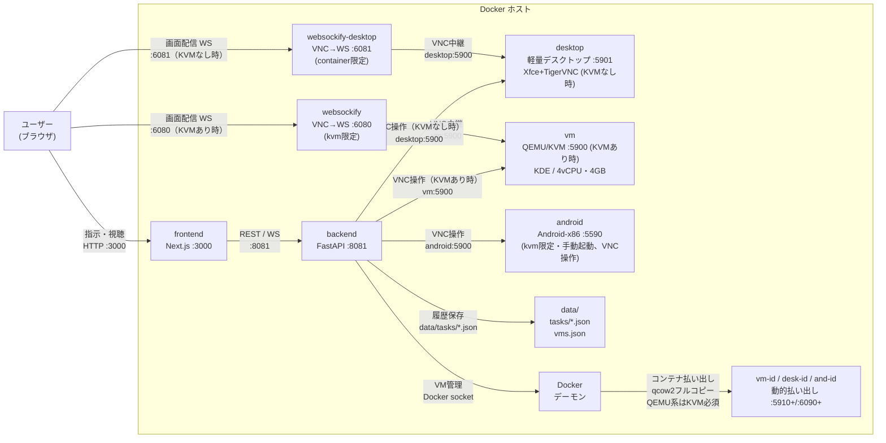

# AI Desktop Agent

自然言語の指示で仮想マシンのGUIをAIが操作する。ブラウザから指示を出し、操作の様子をリアルタイムで見ることができる。

## 構成



指示を受けると、エージェントは画面を取得してマルチモーダルLLMで判断し、マウスとキーボードを動かす。画面はnoVNCビューアで確認できる。

構成はDocker Composeで完結する。初期起動の作業環境は1つに絞る。KVMがある場合はQEMU VMのvmだけ、ない場合は軽量デスクトップのdesktopだけを起動する。図の基準はdocs/architecture.md内のMermaidとする。画像ファイルは管理しない。

| 役割 | 中身 | 公開ポート |
|---|---|---|
| frontend | Next.js。チャットUIとnoVNCビューア | 3000 |
| backend | FastAPI。指示受付とエージェント実行 | 8081 |
| desktop | XfceとTigerVNC。KVMなし時の作業環境。QEMUは不要 | 5901 |
| websockify-desktop | desktop用のVNCからWebSocketへの中継 | 6081 |
| vm | QEMUとKVM。KVMあり時の作業環境。KDE | 5900 |
| websockify | vm用のVNCからWebSocketへの中継 | 6080 |
| android | Android-x86とQEMU。手動起動。VNC操作は通常VMと同じ | 5590 |
| websockify-android | android用のVNCからWebSocketへの中継。手動起動 | 6070 |

ブラウザはlocalhost:3000を開く。frontendからbackendへの通信は:8081、backendから作業環境への通信はDocker内部ネットワークを使う。画面配信はKVMありで:6080、なしで:6081を使う。

## 起動手順

```bash
cp .env.example .env   # APIキーを設定する。KVMの指定は不要で自動判定する
./scripts/up.sh
```

操作UIはhttp://localhost:3000、backendはhttp://localhost:8081で動く。生存確認は/healthを開く。3000番が競合する場合はdocker-compose.override.ymlでずらす。

| 条件 | 起動するもの | backendの接続先 |
|---|---|---|
| KVMあり | vmとwebsockifyとbackendとfrontend | vm:5900。画面配信は:6080 |
| KVMなし | desktopとwebsockify-desktopとbackendとfrontend | desktop:5900。画面配信は:6081 |

androidは初期起動に含まない。使う場合は手動で起動する。

```bash
docker compose --profile kvm up -d android websockify-android
```

起動対象外のサービスは停止状態で残る。削除はしない。backendの接続先はup.shがVNC_HOSTで切り替える。composeの既定値はdesktopとする。

## 作業環境の要件

KVMの切替はUSE_KVMが未設定ならautoとして/dev/kvmの有無で決める。up.shはKVMありで--profile kvm付きのvmのみ、なしで--profile container付きのdesktopのみを起動する。

VMの作り直しと停止と起動は、操作UIのサイドバーにあるVM管理から行う。作り直しはゲストOSごと起動し直す。実行中タスクは止まる。VMタブの停止と起動ボタンは固定と動的のどちらにも使える。停止時は上のタスクを止め、中継も連動する。backendは/var/run/docker.sock経由でDockerを操作する。APIを直接呼ぶ場合はPOST /vm/restart、GET /vm/status、POST /vms/{id}/stop、POST /vms/{id}/startを使う。

## LLM

特定の提供元に依存しない。LLMプロバイダ抽象化層を設け、複数のAPIに対応する。LLM_PROVIDERとLLM_MODELと各種APIキーで切り替える。

| 提供元 | モデル例 |
|---|---|
| Anthropic | Claude |
| OpenAI | GPT-4o、GPT-4.1 |
| Google | Gemini |
| Ollama | Llama、Qwenなど |
| OpenAI互換 | 任意 |
| OpenCode Zen | DeepSeekやGPTやClaudeやGeminiなど |
| OpenCode Go | 月額制のopenモデル群 |

判断の仕組みはdocs/architecture.mdを参照する。

## プロジェクト構成

```text
ai-desktop-agent/
├── docker-compose.yml       # container限定のdesktop系とkvm限定のvm系。初期起動は作業環境1つのみ
├── Dockerfile               # backendコンテナ定義
├── scripts/up.sh            # KVM自動判定で起動する。KVMありはvmのみ、なしはdesktopのみ
├── desktop/                 # KVMなし時の作業環境。XfceとTigerVNCとFirefoxとLibreOffice
├── docs/architecture.md     # エージェント詳細設計。API一覧を含む
├── docs/safety.md           # 安全方針
├── src/ai_desktop_agent/
│   ├── server/app.py        # FastAPIアプリとRESTとWS
│   ├── server/session.py    # タスク実行セッション
│   ├── server/store.py      # タスク履歴の保存。data/tasks配下
│   ├── server/kvm.py        # KVM利用可否判定とVM起動制限
│   ├── server/vm_control.py # VMコンテナ管理
│   ├── server/vm_pool.py    # 動的VMとdesktop検出。既定はdesktop優先
│   ├── agent/loop.py        # 状態機械の遷移管理
│   ├── agent/state.py       # GoalとSubtaskと履歴の定義
│   ├── agent/llm/           # プロバイダ生成とOpenAI互換実装とテスト用モック
│   ├── agent/decision/      # 決定モデル。既定無効でDECISION_PROVIDER切替
│   ├── vm/vnc_client.py     # VNC接続と制御
│   ├── vm/screenshot.py     # 画面取得値オブジェクト
│   ├── vm/overlay.py        # 座標グリッド重畳と領域ズーム
│   └── actions/             # アクション定義と実行エンジン
├── vm/                      # QEMUとKVMコンテナ。ゲストOSイメージ構築を含む
├── frontend/                # Next.jsアプリ。指示入力とログと状態とVM管理とnoVNC視聴
├── websockify/              # VNCからWebSocketへの中継コンテキスト
└── data/tasks/              # タスク履歴の保存先。git管理外
```

## 開発

```bash
uv run pytest -q          # backendテスト
uv run ruff check src tests
cd frontend && npm test   # frontendテスト
```

frontendはNext.jsのApp Routerを使う。チャットUIとnoVNC埋め込みビューアとWebSocket接続とVM管理パネルを持つ。backendはFastAPIとWebSocketを使う。指示受付とエージェント制御とタスク履歴の保存を行う。履歴はdata/tasks/にJSON保存し、GET /tasksで取得する。再起動時は中断扱いにする。

エージェントは単純な繰り返しでは安定しない。このため多段階パイプラインを使う。詳細はdocs/architecture.mdを参照する。

## 安全性

安全方針はdocs/safety.mdに定める。隔離実行と回数上限、事前許可、操作記録を基本とする。

## 資料

- 詳細設計はdocs/architecture.mdを参照する。API一覧を含む
- 安全方針はdocs/safety.mdを参照する
- 決定モデルの検討はdocs/research/clef.mdを参照する
- Android実行環境の手順はandroid/README.mdを参照する

## ロードマップ

- 定型タスクのテンプレート機能
- 同時監視グリッド。現状はタブ切替と単一ビューアのみ
- 決定モデルの有効化と評価。実装済みで既定無効のため、評価後に回復戦略と達成検証を有効化する

## ライセンス

MIT
