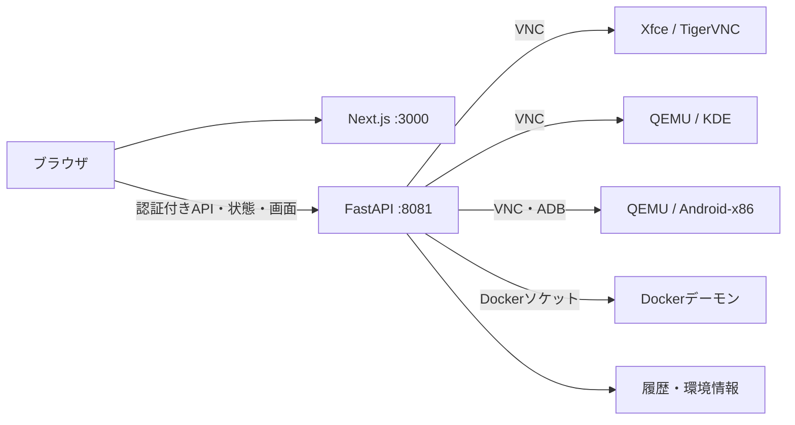

# アーキテクチャ詳細設計

## システム概要

ブラウザから指示を受けたバックエンドが、VNC経由で作業環境を操作する。利用者はnoVNCで画面を見ながらタスクを制御する。

| コード | 役割 |
| --- | --- |
| [frontend/src](../frontend/src) | 操作画面、状態・履歴表示、noVNCビューア |
| [server](../src/ai_desktop_agent/server) | 認証、API、作業環境の管理、タスクの実行と保存 |
| [agent](../src/ai_desktop_agent/agent) | 状態遷移、モデル呼び出し、実行予算 |
| [actions](../src/ai_desktop_agent/actions) | 操作の型と引数の検証、操作の実行 |
| [vm](../src/ai_desktop_agent/vm) | 画面取得、VNC入力、QMP・QGA通信 |

ホストのループバックに操作画面（3000）とAPI・状態通知・画面配信（8081）を公開する。VNC・ADBはDocker内部で使う。管理用ネットワークと作業環境ごとの専用bridgeを分け、バックエンドだけが両方に接続する。APIは管理用IPで待ち受け、実際の送信元を確認する。移行・再接続・削除では環境とネットワークの所属を照合する。旧版のVNC公開設定は環境を再作成するまで残る。[安全性と利用範囲](safety.md#実行する範囲)を参照する。

## バックエンド

[app.py](../src/ai_desktop_agent/server/app.py)がAPIとWebSocketを提供する。[auth.py](../src/ai_desktop_agent/server/auth.py)が接続キーとセッションを管理し、ブラウザには12時間有効なHttpOnly・SameSite=Strict Cookieを発行する。HTTPSではSecureも付ける。APIクライアントは `Authorization: Bearer` を使える。セッションはログアウトまたはバックエンドの再起動でも失効し、対応するWebSocketを閉じる。

標準起動は1プロセスで動く。同じ保存先でバックエンドを二重起動すると、履歴や環境を操作する前に拒否する。HTTP本文は256 KiB・受信時間5秒まで、WebSocketは受信1メッセージ1 MiBまでとなる。ログインとBearer認証は接続キーの照合失敗を共有し、直近60秒に10回失敗すると一時制限する。

### エンドポイント

| 方法 | パス | 用途 |
| --- | --- | --- |
| GET | `/health`、`/auth/status` | 生存確認、認証状態 |
| POST | `/auth/login`、`/auth/logout` | ログイン、ログアウト |
| POST | `/tasks` | タスク投入。`instruction`、`vm_id`、`allow_vm_restart` を受け取る。`replace_running=false` で実行中の環境への投入を拒否する |
| GET | `/tasks`、`/tasks/{task_id}` | 新しい順の履歴一覧、操作・判断・実行結果を含む詳細 |
| DELETE | `/tasks/{task_id}` | 実行中なら停止してから履歴を削除する |
| GET | `/tasks/current` | 最新タスクの状態。`vm_id` で環境を指定できる |
| POST | `/tasks/current/{pause,resume,stop}` | 一時停止・再開・停止。`session_id` を指定すると対象を照合し、不一致や消失は409を返す |
| GET、POST | `/vms` | 環境の一覧、作成。作成時の `kind` は `qemu`（既定）、`container`、`android` |
| POST、GET | `/vm-creations`、`/vm-creations/{job_id}` | 環境作成の受付、作成状況と結果 |
| POST | `/vms/{vm_id}/{start,stop}` | 固定・動的環境の起動・停止 |
| DELETE | `/vms/{vm_id}` | 環境の削除。動的環境では保存用ディスクやボリュームも削除する |
| GET、POST | `/vm/status`、`/vm/restart` | 既定VMの状態・QMP応答の取得、実行中タスクを止めて再起動 |
| WS | `/ws`、`/vnc/{vm_id}` | 状態・操作ログの通知、認証付き画面配信 |

`/health` と認証用エンドポイントを除き、認証が必要となる。準備中・異常・不明の環境にはタスク投入を拒否する（409）。画面配信はコンテナが稼働中なら準備中も使える。タスク投入と環境操作は環境単位で直列化する。接続・保存・中断後の解放が終わるまで同じ環境の次の操作を待たせ、別環境の操作は進める。

### タスク投入の再送

`POST /tasks` の `Idempotency-Key` は省略できる。指定する場合はASCII英数字・ハイフン・アンダースコアで16〜128文字にする。同じキーと内容の再送は受付済みタスクを `replayed=true` で返す。内容の不一致と受付処理中は409、受付済みタスクの履歴を削除していれば410を返す。キーを省略すると毎回新しいタスクを作る。

タスク記録と受付記録を保存してからモデルを呼ぶ。受付記録にはキーと要求内容のハッシュ、タスクIDを保存し、履歴削除後やバックエンド再起動後の照合にも使う。記録の破損時は503を返す。

### 環境作成の再送

操作画面は `POST /vm-creations` に `Idempotency-Key` を付け、受付IDで `queued`・`running`・`succeeded`・`failed` を確認する。同じキーと内容なら完了後や環境削除後も元の受付を返し、内容が異なる場合は409を返す。新しく作る場合は別のキーを使う。払い出し後の利用可否は `GET /vms` の `status`・`health` で確認する。

再起動時は未開始の作成を再開し、開始済みの作成は対象IDで照合する。対象が存在すれば作成済みとして扱い、なければ作成に属する資源を回収して中断を記録する。作成の実行中と待ちは、新旧APIを合わせて8件まで受け付ける。超過は429と `Retry-After` を返す。

### 永続化

| 保存先 | 内容 |
| --- | --- |
| `data/tasks/` | タスク状態、指示、操作、判断、結果、使用量、停止理由 |
| `data/task-order.json` | タスクの開始順。ファイルがなければ履歴に残る最大値から再開する |
| `data/submissions/`、`data/vm-creations/` | タスク投入と環境作成の受付記録 |
| `data/vms.json` | 追加環境の種類、接続先、保存先 |
| `data/auth/access-key` | 自動生成した接続キー |

履歴と環境情報は一時ファイルへの書き込みと置き換えで保存し、ディスクへ同期する。履歴一覧は全ファイルを読み、操作履歴の全件をメモリには保持しない。不正な履歴は元のファイルを残して読み飛ばす。

バックエンドを止めてからデータを復元し、復元後に再起動する。再起動時に実行中だったタスクは履歴で中断扱いになる。書き込みに失敗すると起動・投入・以後の操作を止める。開始順の破損では新規タスクを、環境や作成記録の破損では該当する操作を止め、元のファイルを保持する。空き容量・アクセス権・バックアップを確認する。

## 状態機械と実行フロー

有効な状態遷移は [agent/state.py](../src/ai_desktop_agent/agent/state.py) の `_VALID_TRANSITIONS` が定義する。[TaskSession](../src/ai_desktop_agent/server/session.py) は指示から意図・対象・制約を抽出し、期待結果を持つサブタスクに分ける。サブタスクごとに画面を取得して次の操作を決め、実行後に画面が安定するまで待つ。

クリック後は画面の変化を確認し、完了宣言では画像を使って期待結果を検証する。無変化や未達なら理由を添えて回復へ進む。まったく操作していない段階の完了宣言は最大2回まで再問い合わせする。低確信度のクリックは対象を拡大して再判断し、それでも位置を確定できなければ実行を見送る。再計画では完了済みのサブタスクを残す。1タスクは回復を含め200アクション、再計画は3回までとなる。

実行中は一時停止できる。`request_user_input` で手動入力待ちに入ると画面取得とモデル呼び出しを止める。`manual_input_id` と `allow_screen_share=true` を照合してから、元の実行または回復に戻る。AIの環境再起動には `allow_vm_restart=true` が必要で、再起動後は60秒待って画面を確認する。ディスクは保持する。

[agent/budget.py](../src/ai_desktop_agent/agent/budget.py) はモデル送信前、使用量の受信時、画面操作前に予算を確認する。モデルの再試行と決定モデルも同じ予算を使う。期限切れでは画面操作に停止を要求し、実行中の処理が終わってから接続を解放する。[上限の設定](../README.md#実行上限を変える)と[停止時の挙動](safety.md#実行と停止)を参照する。

## 意思決定層

[agent/llm](../src/ai_desktop_agent/agent/llm) のプロバイダが、指示の理解・タスク分解・座標や操作内容の生成を担う。モデルへの画像は元のサイズのJPEGで送る。構造化出力に対応しないモデルではJSONモードに切り替え、どちらの場合も応答型と操作引数を検証する。

次の操作を判断するときは、最新の画面とサブタスク、直近10件までの操作履歴、最大400文字の `Goal.working_note` を渡す。たとえば依頼書から読んだ金額をCalcに転記するときは、画面を切り替える前に値と出典をメモに残す。空の更新は前のメモを保持し、値があれば置き換える。新しいタスクは空のメモから始まる。

[agent/decision](../src/ai_desktop_agent/agent/decision) の決定モデルは、サブタスクの達成確認と回復戦略の選択に使える。既定の `DECISION_PROVIDER=none` ではLLMが判断する。`clef` はWorkers AI、`clef-openrouter` はOpenRouterのDecisions APIを使い、後者は `CLEF_API_KEY` を別に設定できる。中間の確信度、不正な応答、呼び出し失敗では予算内でLLMに切り替える。[評価手順](research/clef.md)を参照する。

## 観測とアクション実行

[screenshot.py](../src/ai_desktop_agent/vm/screenshot.py) と [overlay.py](../src/ai_desktop_agent/vm/overlay.py) が座標グリッド付きの画像を作る。拡大画像で選んだ座標は切り出し位置と縦横それぞれの実倍率を使って元画像へ戻す。画面の文字はモデルが画像から読み取る。黒画面ではウェイクを試み、画面が変わっていなければ次の判断に伝える。

[executor.py](../src/ai_desktop_agent/actions/executor.py) は検証済みの操作をVNC入力に変換する。VNC操作は直列化し、10秒で応答がなければ接続を閉じる。日本語や絵文字は対応コンテナのRFB Extended Clipboardで貼り付ける。入力は64 KiBまでで、QEMU・AndroidのUnicode入力は未対応となる。

## VM操作

| 環境 | 起動と保存 |
| --- | --- |
| 固定 `desktop`、追加コンテナ | XfceとTigerVNC。KVM不要。固定環境と新しい追加環境は環境専用ボリュームに `/home/agent` を保存する |
| 固定 `vm`、追加QEMU | QEMUとKVMでKDEを起動する。固定は `vm/instances/default.qcow2`、新しい追加VMは `vm/overlays/環境ID/disk.qcow2` に独立したディスクを持つ |
| 固定 `android`、追加Android | QEMUでAndroid-x86を起動する。[Androidの準備と保存先](../android/README.md)を参照する |

[VmPool](../src/ai_desktop_agent/server/vm_pool.py) は動的環境を全種別合計8台まで払い出す。固定環境は停止・削除後も保存先を残す。追加VM・Androidの保存先を自動検出できない場合は、ホスト上のリポジトリの絶対パスを `VM_HOST_DIR` に、ISOの絶対パスを `ANDROID_ISO_HOST` に指定する。追加VMで実行イメージの更新が必要なら `./scripts/up.sh` を実行する。`VM_IMAGE_REF` を指定している場合は対応するイメージへ更新する。

[vm/build-vm-image.sh](../vm/build-vm-image.sh) はUbuntu 24.04とKDEのテンプレート `vm/desktop.qcow2` を構築する。作業領域を分け、成果物が揃ってから出力を更新する。更新の失敗や中断時は旧ファイルへの復元を試み、復元やマウント解除に失敗すると作業領域を残して保存先を表示する。テンプレートを再構築しても既存VMのディスクは保持する。

[vm/prepare-boot.sh](../vm/prepare-boot.sh) は起動時に各qcow2を一時領域へコピーするため、保存先に空き容量が必要となる。コピーからカーネルとinitrdを取得し、読み出しに失敗した場合は元ディスクを変更せず起動を止める。KVMなしのQEMU起動は、デバッグ用の `ALLOW_TCG_VM=true` を明示した場合に限り許可する。

[VmController](../src/ai_desktop_agent/server/vm_control.py) が既定VMの状態と再起動を扱う。Dockerの照会失敗や再起動の応答消失は503を返す。再起動済みの場合があるため、状態を確認してから再操作する。QMPは状態確認、QGAはゲストの診断に使う。QMPとQGAは要求IDが一致する応答を使い、1応答は4 MiBまでとなる。QGAの待ち時間を超過してもゲスト内の処理は続く場合がある。

固定desktopの更新には `./scripts/up.sh` を使う。更新ロックを保持し、ホームをバックアップして内容とアクセス権を照合してから再作成する。失敗時は元のコンテナの再開を試みる。[ホームの保存範囲と復元手順](workspace-backups.md)を参照する。

## フロントエンド

操作画面は環境ごとに状態と履歴を保持し、選択中の環境だけを表示する。WebSocket再接続時に全環境の状態を同期する。バックエンドの起動ID、タスクの開始順、状態の更新番号で古い通知を除外し、履歴の選択や入力中の指示を保持する。一時停止・再開・停止は画面で確認したタスクIDを指定する。

タスクの再送情報と環境作成の受付キーは同じタブに保持する。ブラウザの保存領域が使えない場合はページ内だけで保持し、タスクの照合にはWeb Cryptoも必要となる。タスク投入の応答待ちは30秒、環境作成とデバッグ再起動の確認は10分までとなる。確認の期限後も処理が続く場合があるため、環境や履歴の状態を確認してから再操作する。

## 運用上の制限

任意の秘密情報や画像の自動マスキング、複数利用者の権限分離、複数バックエンドでの同時運用は未対応となる。コンテナの管理にはDockerソケットを使う。[利用時の注意](safety.md)と[本番利用に向けた確認事項](production-readiness.md)を参照する。
