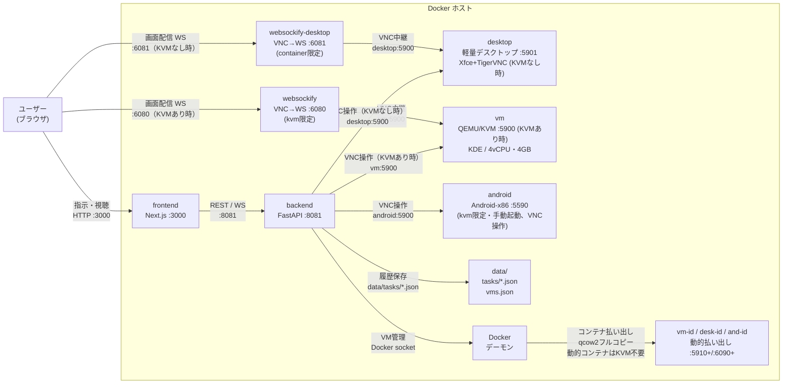
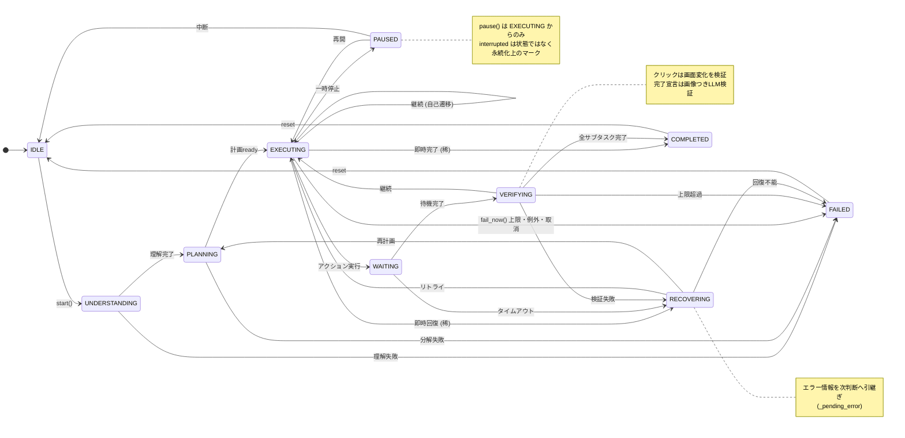
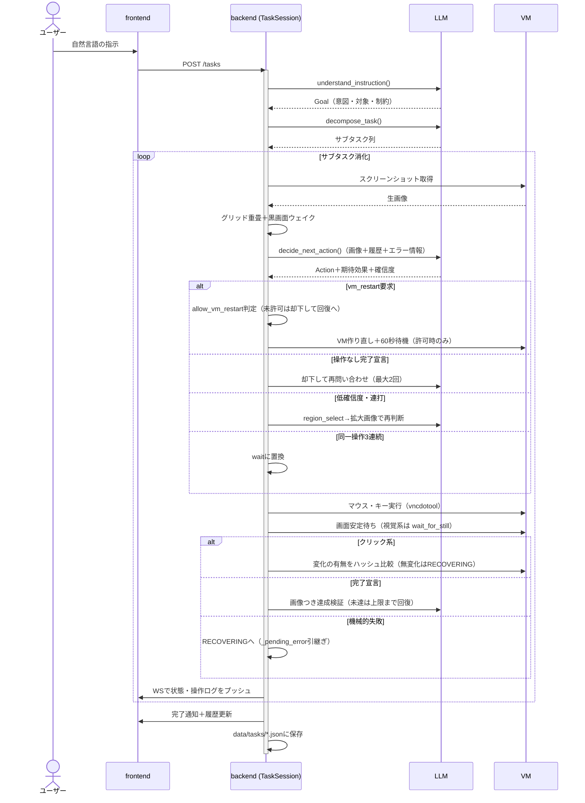
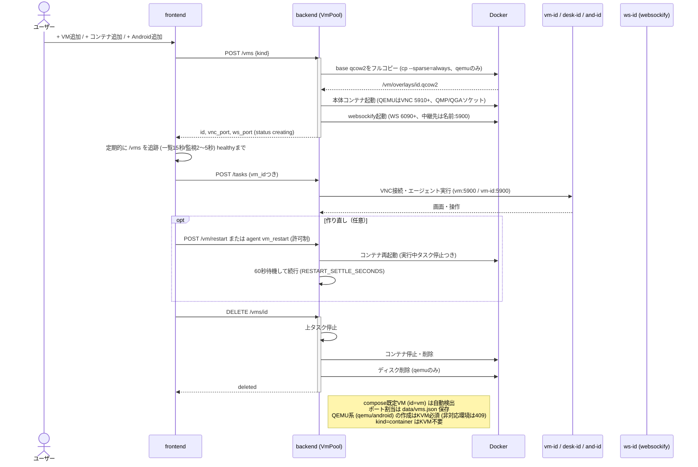

# アーキテクチャ詳細設計

本書は実装の実態に合わせた設計書である。コードを読む際の地図として使う。主要モジュールはsrc/ai_desktop_agent/配下のserverとagentとactionsとvm、frontend/src/、vm/のゲストコンテナ定義とする。

## 目次

1. [システム概要](#システム概要)
2. [バックエンド](#バックエンド)
3. [状態機械と実行フロー](#状態機械と実行フロー)
4. [意思決定層](#意思決定層)
5. [観測](#観測)
6. [アクション実行](#アクション実行)
7. [VM操作](#vm操作)
8. [フロントエンド](#フロントエンド)
9. [安全性](#安全性)
10. [制限と今後](#制限と今後)
11. [図の管理](#図の管理)

図は本文中のMermaidブロックで管理する。別ファイルや画像生成は不要とする。GitHubとVS CodeのMarkdownプレビューでそのまま表示できる。

## システム概要

自然言語の指示で仮想マシンのGUIをAIが直接操作する。利用者はブラウザから指示を出し、AIがVMを操作する様子をnoVNCビューアで見ることができる。



| 名称 | 中身 | ポート | 役割 |
|---|---|---|---|
| frontend | Next.js | 3000 | チャットUIとnoVNCビューアとVM管理 |
| backend | FastAPI | 8081 | 指示受付とエージェント実行とタスク保存 |
| desktop | XfceとTigerVNC | 5901 | KVMなし時の作業環境。QEMUは不要でcontainer限定 |
| websockify-desktop | VNCからWSへの中継 | 6081 | desktop向け画面配信でcontainer限定 |
| vm | QEMUとKVM | 5900 | KVMあり時の作業環境。KDEでkvm限定 |
| websockify | VNCからWSへの中継 | 6080 | vm向け画面配信でkvm限定 |
| android | Android-x86とQEMU | 5590 | Android端末でkvm限定の手動起動。VNC操作は通常VMと同じ |
| websockify-android | VNCからWSへの中継 | 6070 | android向け画面配信でkvm限定の手動起動 |

動的環境は5910番台のVNCと6090番台のWSを使い、台数分コンテナが増える。vmとwebsockifyとandroidとwebsockify-androidはkvmプロファイル配下にある。このためKVMあり時の./scripts/up.shかdocker compose --profile kvm upでのみ起動する。desktopとwebsockify-desktopはcontainerプロファイル配下にある。このためKVMなし時の./scripts/up.shかdocker compose --profile container upでのみ起動する。初期起動の作業環境は1つに絞る。up.shはKVMありでvm系のみ、なしでdesktop系のみを起動する。androidは初期起動に含まない。詳細はVM操作の節を参照する。

| 送信元 | 送信先 | 経路 |
|---|---|---|
| ブラウザ | backendのAPIとWS | ホストの:8081 |
| ブラウザ | 画面配信 | KVMありはホストの:6080、なしはホストの:6081。Androidはホストの:6070 |
| backend | desktopのVNC | desktop:5900。KVMなし時でDocker内部ネットワーク |
| backend | VMのVNC | vm:5900。KVM時で動的VMはvm-ID:5900 |
| backend | AndroidのVNC | android:5900。動的はand-ID:5900 |
| websockify-desktop | desktopのVNC | 同上 |
| websockify | VMのVNC | 同上 |
| websockify-android | AndroidのVNC | 同上 |
| backend | Docker | /var/run/docker.sock。VM作成と再起動用 |

代表的な環境変数はLLM_PROVIDERとLLM_MODELと各種APIキー、VNC_HOSTとVNC_PORT、USE_KVMの既定値はautoで未設定時は/dev/kvmの有無で自動切替、ALLOW_TCG_VMの既定値はfalse、VM_MEMORYの既定値は4096とVM_CPUSの既定値は4、DATA_DIRの既定値は./dataとする。VNC_HOSTのdesktop既定はcomposeのみとし、backend単体既定はlocalhostとする。VM_MEMORYとVM_CPUSの固定値はcomposeで定め、動的払い出しのみ起動時引数で変えられる。

## バックエンド

src/ai_desktop_agent/server/app.pyがAPIとWebSocketを提供する。

### エンドポイント

| 方法 | パス | 用途 |
|---|---|---|
| GET | /health | 生存確認 |
| POST | /tasks | タスク投入。instructionとvm_idとallow_vm_restartを指定できる |
| GET | /tasks | 履歴一覧。新しい順に返す |
| GET | /tasks/{id} | タスク詳細。操作履歴と推論を含む |
| DELETE | /tasks/{id} | 履歴削除。実行中なら止めてから消す |
| GET | /tasks/current | 最新タスク状態。リロード後の復元用でなければidle |
| POST | /tasks/current/{pause,resume,stop} | タスク制御 |
| GET | /vms | VM一覧 |
| POST | /vms | VM作成。ディスク複製と起動を行う |
| DELETE | /vms/{id} | VM削除。上のタスク停止とコンテナ削除を行い、動的はディスクも消す |
| POST | /vms/{id}/stop | VMとコンテナの停止。固定と動的に使え、上のタスク停止と中継連動を含む |
| POST | /vms/{id}/start | VMとコンテナの起動。固定と動的に使え、中継連動を含む。QEMU系はKVM必須 |
| GET | /vm/status | 既定VMの状態。DockerとQMPで確認する |
| POST | /vm/restart | 既定VMの作り直し。実行中タスク停止を含む |
| WS | /ws | 状態と操作ログの配信 |

### セッション管理

1タスクは1つのTaskSessionに対応する。server/session.pyで定義し、POST /tasksごとに生成する。登録先はserver/app.pyの_sessionsでsession.idを鍵とする。_active_sessionは後方互換のための最新1件とする。セッションはvm_idを持ち、指定VMのVNCClientにset_displayで切り替える。vm_id省略時は稼働中の既定VMを使う。VmPool.default_vmで選ぶ。稼働中のdesktopがあれば順序によらず優先する。WebSocket配送は全体登録のファンアウトで行う。stateとactionとerrorとcompleteにsession_idとvm_idを付ける。初回のno_sessionとpongは除く。フロントは選択中のVMで選別する。

### 永続化

data/tasks/タスクID.jsonに1タスク1ファイルで保存する。状態遷移とアクション実行のたびに更新する。server/store.pyが担う。TaskRecordは指示と状態と成否、操作履歴と判断理由と確信度、サブタスクと進捗index、vm_id、Goal、トークン使用量を持つ。トークン使用量はpromptとcompletionと呼出回数に加え、decision_callsとdecision_escalationsを持つ。起動時は実行中だった記録をinterruptedに変える。mark_interruptedで行う。保存先が書けない環境では一時ディレクトリに退避して動作を続ける。

### KVM判定

server/kvm.pyが判定基準を持つ。判定順序はUSE_KVM明示値、backendの/dev/kvm、Docker上のvmサービス存在の順とする。KVMなし環境のVM作成と再起動はKvmUnavailableErrorで拒否する。APIは409を返し、ALLOW_TCG_VM=trueでのみ明示許可する。

### VM制御

server/vm_control.pyのVmControllerが既定VMの状態取得と再起動を担う。状態にQMPのquery-status結果をqmp_statusとして添える。Docker不通時はDockerUnavailableErrorとして503を返す。

### VMプール

server/vm_pool.pyのVmPoolが環境の一覧と作成と再起動と削除、compose管理のdesktop検出を担う。desktop検出はidがdesktop、managedがFalse、既定ポートが5901と6081とする。default_vmは稼働中のdesktopを順序によらず優先する。なければ稼働中の先頭を返す。POST /vmsはkindで種別を選ぶ。qemuが既定でcontainerとandroidも選べる。qemu作成時はbase qcow2のフルコピーを払い出す。backing参照はロック競合のため使わない。VNCとWSポートは5910番台と6090番台から割り当て、割当結果をdata/vms.jsonに保存する。動的AndroidのADB用にホスト側5570番台も払い出す。container作成時は軽量デスクトップと中継の2コンテナを払い出す。KVM不要でどこでも作れる。動的VMのidはvm-16進数、動的コンテナはdesk-16進数、動的Androidはand-16進数とする。上限は8台でMAX_VMSとし、両種別の合計とする。動的QEMU VMは/dev/kvmを常時要求する。一覧の種別はkindでqemuとcontainerとandroidを返す。固定のvmとdesktopとandroidもDELETE /vmsで削除できる。本体と中継を止めて消す。ホストパス解決はbackend自身の/app/dataマウント元から逆算する。_host_repo_dirで行う。

## 状態機械と実行フロー

### 状態と遷移

有限状態機械とする。agent/state.pyとagent/loop.pyで定義し、AgentLoopが有効遷移のみを通す。不正遷移はInvalidTransitionErrorとする。有効遷移の基準は_VALID_TRANSITIONSでagent/state.py:29に置く。



状態はIDLEとUNDERSTANDINGとPLANNINGとEXECUTINGとWAITINGとVERIFYINGとRECOVERINGとPAUSEDとCOMPLETEDとFAILEDとする。PAUSED以外の停止系は終端扱いとする。interruptedは状態機械の状態ではない。再起動後に付け替える永続化上の目印とする。pauseはEXECUTINGからのみ行える。fail_nowは上限と例外と取消時に打ち切るための遷移とする。loop.pyのunderstanding_failedとwait_timeoutとrecover_replanとabortは定義のみで、現行フローから呼ばない。UNDERSTANDINGの失敗は汎用例外処理でFAILED化する。

### 実行フロー

TaskSessionの実行順序はserver/session.py:runに置く。



処理は次の順序で進む。まずUNDERSTANDINGでunderstand_instructionにより指示をGoalに変える。Goalは意図と対象アプリと制約とする。失敗時は専用遷移を呼ばず、汎用例外処理でFAILED化する。次にPLANNINGでdecompose_taskによりサブタスク列に分ける。サブタスクはIDと説明と期待結果を持つ。続いてEXECUTINGからWAITINGを経てVERIFYINGに戻る循環に入る。_execute_phaseが担う。画面取得では重畳付き画像を使う。真っ黒ならShiftキーを送って復帰させ、再取得する。前回と同一画面なら無変化の旨をLLMに渡す。操作なし完了宣言は最大2回まで却下して問い直す。MAX_EMPTY_COMPLETE_REFUSALSと_is_empty_completeで判定する。低確信度クリックと同一座標連打はregion_select拡大フローへ回す。同一アクション3連続はwaitに置き換える。足踏みを止めるためである。vm_restartは専用フローで処理する。座標は画面内に収めてから実行する。視覚系操作後は画面安定待ちを行う。wait_for_stillを使う。ステップ上限200を超えるとfail_nowで打ち切る。MAX_ACTIONS_PER_TASKで定める。

VERIFYINGでは_verify_phaseが機械的失敗をRECOVERINGへ回す。エラー情報は次判断へ引き継ぐ。クリック系は画面変化の有無をハッシュ比較する。無変化は空振りとしてRECOVERINGへ回す。subtask_completeは期待結果の達成を画像付きでLLM検証する。_verify_subtask_phaseで行う。未達は上限まで回復し、超過でfail_nowとする。上限はmax_retriesで定める。

RECOVERINGではrecover_from_errorで回復計画を作る。recoverableが真なら再試行し、偽なら失敗とする。計画のstrategyは現状では再試行可否のみに使う。例外と取消時は必ずFAILEDに移して保存する。記録なしに終わらせない。一時停止中は遷移前に_wait_if_pausedで再開を待つ。DELETE /tasksとPOST /vm/restartの停止対象は_active_sessionのみとし、_sessions内の非実行セッションは対象外とする。

### VM作り直し

アクションはvm_restartのreason指定でactions/primitives.pyに定義する。タスク投入時のallow_vm_restartが真の場合のみ実行する。UIのチェックボックスで指定する。未許可なら却下して回復フローへ回し、別手段を促す。実行後は環境初期化として回復フローに戻し、新画面で再判断する。再起動後はRESTART_SETTLE_SECONDSの60秒待ってから続ける。

## 意思決定層

判断は生成系LLMと決定モデルの分担を方針とする。生成の座標と文章と計画はLLM、定型判断の成否と戦略選択は決定モデルに寄せる。

### LLMプロバイダ

agent/llm配下に置く。factory.pyのcreate_llm_providerが全提供元をOpenAICompatProviderに束ねる。対応はopenaiとanthropicとopenrouterとopencodeのZen、opencode-goのGo、ollama、mockとする。既定モデル例はgpt-4oとdeepseek-v4.1-flashとする。LLM_PROVIDERとLLM_MODELと各種APIキーで切り替える。

openai_compat_provider.pyの仕様は次の通りとする。画像は同一解像度JPEGのq80とdetail highで送る。座標系を保ちつつ軽くするためである。出力形式はStructured Outputのresponse_format json_schemaで強制する。非対応モデルでは通常JSONモードへ自動切替する。_structured_output退避で行う。不正な引数は_sanitize_paramsで整え、画面内収めは_clamp_paramsで行う。必須項目の欠落はActionの検証で誤りとする。OpenCode系にはUser-Agentのai-desktop-agent/0.1.0を付け、タスクIDをx-opencode-sessionで送る。session_idに対応する。呼出ごとのトークン使用量は_record_usageで累積し、タスク記録に保存する。max_tokensは1500に絞る。出力は小さいJSONのみのためである。

システムプロンプト方針は座標グリッドの読み方、2段階クリック、アプリ起動はキーボード優先、不足アプリは端末で導入、subtask_completeは操作後のみとする。画面文字はLLMが画像から直接読む。

### 決定モデルの組込

実装済みとする。agent/decisionに置き、受け付ける型はnoulの成否とchoiceの戦略選択とscoreの評価の3型とする。System One互換APIで受け、提供元はDECISION_PROVIDERで切り替える。noneは従来動作で既定とし、mockは外部通信なしの簡易判定、clefはWorkers AI直結のClefとclef-flash、clef-openrouterはOpenRouter Decisions API経由のClef系を使う。clef-openrouterのみLLM本体と別のAPIキー（CLEF_API_KEY優先、なければOPENROUTER_API_KEY）を使える。既定モデルはclef-flashとする。中間帯と失敗時はLLMに退避するため、誤判定より退避を優先する。利用実績はdecision_callsとdecision_escalationsで記録する。

| 番号 | 組込点 | 置換対象 | 期待効果 |
|---|---|---|---|
| 1 | 回復戦略の選択 | _recover_phaseのLLM呼出 | 数百msで戦略確定。文章生成が不要な分類に適する |
| 2 | サブタスク達成検証 | _verify_subtask_phaseの画像付きLLM検証 | 高確信で前進し、低確信で回復し、中間でLLM検証へ回す。確率閾値で設計する |
| 3 | 評価ハーネス | なし。新設済み | 保存済みタスク記録を正解集団とし、精度と分布を測る。agent/decision/eval.pyとscripts/eval_clef.pyを使う。推奨順序はClef-flashからClefとする |

置換しないものはdecide_next_actionの座標とJSON生成、タスク分解、画面文字の読解とする。判断は決定モデル、実行内容の生成はLLMの分担を保つ。ベンチマークは提供元申告のため、自タスクでの精度と待ち時間と単価で選ぶ。利用可否の検討内容はdocs/research/clef.mdに残す。

## 観測

LLMに渡すのは生画像ではない。座標ヒントを重ねた画像と文字情報とする。

画面取得の値オブジェクトはvm/screenshot.pyに置く。with_overlayとcrop_with_metaを持つ。重畳描画はvm/overlay.pyに置く。50pxグリッドと100pxごとの太線、上端と左端の座標数字、カーソル十字、外周枠を描く。文字は12ptとする。ズーム画像には25pxグリッドを使う。領域ズームはcrop_region_with_metaで行い、2倍拡大画像と実倍率を返す。逆変換はabsolute = origin + zoomed_coord / actual_scaleで行う。_handle_region_zoomが担う。入れ子は深さ1までとする。

画面文字の読解はLLMが画像から直接行う。OCR機構（vm/ocr.py・WAIT_FOR_TEXT）は実画面ABで有益信号がなく削除した。

カーソル情報はVNCClientのcursor_positionとhas_custom_cursorを使う。cursor_positionは通信層の値を優先し、取れなければ内部追跡値を返す。重畳の十字には内部追跡の_cursor_xと_cursor_yを直接使う。

照合はvm/matcher.pyに置く。PILのみの正規化相互相関とし、単色はSAD併用、粗密2段階とする。executor.locateから利用できる。テンプレート供給元は今後の課題とする。

黒画面ウェイクはDPMS消灯などで全面真っ黒を検出したら起こして再取得する。平均輝度2.0未満を黒とみなし、最大1回まで行う。_is_black_screenで判定する。Linux系はShiftキーを送る。Android端末のandroidとand始まりは公式手順に沿い、ESCからMenuの1秒超保持と中央タップを行う。VNCClient.wake_androidが担う。実機の深い休止では戻らない場合がある。このためAndroidの休止対策は初期設定での無効化を本命とする。内容は休止最大と起床状態維持ONと画面保護無効とし、ADBのshell命令のみで行う。画面施錠の無効化命令は含まない。VNCタップ列は使わない。到達不能時は警告記録に留め、次回に再試行する。

無変化検出は前回のハッシュ比較で行い、画面が変わっていない旨を次判断に伝える。

## アクション実行

定義はactions/primitives.pyに置く。マウス7種とキー4種と待機3種、内部用のscreenshot、region_select、subtask_complete、vm_restartを持つ。クリック系は座標必須とする。allowed_paramsとrequired_paramsで検証する。

実行はactions/executor.pyに置き、Actionをbackend操作に変える。REGION_SELECTとVM_RESTARTはセッション側で処理する。このため実行器に届いた場合は警告のみ出す。安定待ちのwait_for_stillを持つ。

VNC実装はvm/vnc_client.pyに置き、vncdotoolを包む。既知の注意点と対策は次の通りとする。pasteの貼付はQEMU標準VNCに無視されるため使わない。type_textは1文字ずつキーイベントを送る。QEMUはShift合成を戻さないため、_SHIFT_PAIRS表で明示合成する。大文字AからZはそのまま通す。手動合成すると小文字化する実測があるためである。vncdotoolのKEYMAPに無い名前のbackspaceなどは起動時に補う。ThreadedVNCClientProxyは戻り値なし呼び出しで後続呼び出しが動かなくなる。deferred連鎖に前回戻り値が流れるためである。keyEventとmouseDragの直接利用は禁止とする。mouseDragはmouseMove連打の自前段階に置き換え済みとする。クリックは移動と整定待ち、50ms押下、解放の順に行う。ダブルクリックは同座標明示とする。組合せキーは20ms間隔とする。座標は画面内に収める。

## VM操作

### 実行環境の3種

desktopはdesktop配下に置き、KVMなし時の作業環境とする。XfceとTigerVNCの軽量コンテナとし、QEMUは不要とする。containerプロファイル配下に置く。このためKVMなし時の./scripts/up.shかdocker compose --profile container upでのみ起動する。VNCはdesktop:5900でホスト公開5901、画面配信はwebsockify-desktopの:6081とする。解像度は1280x800でVNC_GEOMETRYとし、認証なしで隔離網前提とする。FirefoxとLibreOfficeのWriterとCalc、xdotool、wmctrlを同梱する。

vmはvm配下に置き、KVMあり時の作業環境とする。QEMUとKVMの重い隔離デスクトップでKDEとする。kvmプロファイルでのみ起動する。./scripts/up.shが/dev/kvmの有無で自動判定する。初期起動ではvmのみを起動し、desktopとandroidは起動しない。1つに絞って軽くするためである。backendの接続先はup.shが環境に合わせて切り替える。KVMありはvm、なしはdesktopとし、compose既定はdesktopとする。VmPool.default_vmはdesktop稼働時にはdesktopを優先する。

androidはAndroid-x86をQEMUで動かし、動的払い出しとandroidサービスで提供する。QEMUとKVM上でAndroid-x86のISOをLive起動する。VNC操作は通常VMと同一のため、VNCClientをそのまま使う。タップはクリック、スワイプはドラッグに対応付ける。KVM必須でkvmプロファイル配下とする。ISOはandroid/android-x86_64.isoに配置する。容量のためgit管理外とし、手順はandroid/README.mdに置く。休止しない設定は初回配備で入れる。AndroidProvisionerとandroid_adbで行う。内容は休止最大と起床状態維持ONと画面保護無効とする。ADBのshell命令のみとし、画面施錠の無効化命令は含まない。VNCタップ列は使わない。seed同梱なしで空dataから設定し、定期的なキー送信はしない。到達不能時は警告記録に留め、次回に再試行する。QEMUのADB転送のhostfwdは既定ONとする。詳細はandroid/README.mdに置く。

### KVM自動切替と起動制限

USE_KVM未設定時はautoとして/dev/kvmの有無で自動切替する。.env指定は不要とする。明示値のtrueは必須、falseはTCG扱いとする。KVMがない環境のVM作成と再起動は制限する。TCGは実用速度が出ないためである。制限は3層で行う。backendのKvmUnavailableErrorでAPI 409、vm/entrypoint.shの起動拒否でALLOW_TCG_VM=trueでのみ明示許可、composeでvmとwebsockifyをkvmプロファイル配下に配置とする。エージェント判断のvm_restartが制限環境で要求された場合は失敗として_pending_errorに渡し、別手段での継続を促す。

動的VMとコンテナの全体手順は次の通りとする。VmPoolのserver/vm_pool.pyがDocker経由で本体コンテナとwebsockifyコンテナを対で払い出す。QEMU VMはKVM必須、コンテナは不要とする。



### QEMU起動構成

vm/entrypoint.shに置く。

```text
qemu-system-x86_64 -enable-kvm -cpu host -smp $VM_CPUS -m $VM_MEMORY
  -kernel /vm/vmlinuz -initrd /vm/initrd.img -append "$CMDLINE"
  -drive file=$VM_IMAGE,if=virtio,format=qcow2
  -vnc 0.0.0.0:$VNC_DISPLAY -device virtio-net,netdev=net0 -netdev user,id=net0
  -serial stdio -display none
  -chardev socket,path=$QMP_SOCK,... -mon chardev=...,mode=control
  -chardev socket,... -device virtio-serial-pci -device virtserialport,...,name=org.qemu.guest_agent.0
```

KVMとhost CPU、4vCPUと4GBを既定とする。固定値はcomposeで定める。マシン型は変えない。NIC名のens3がnetplanに固定のためである。USE_KVM=auto時は/dev/kvmの有無でKVMとTCGを自動選択する。TCG側は既定で起動拒否し、ALLOW_TCG_VM=trueでのみ許可する。許可時のTCGは-cpu qemu64と-smp 1に切り替わる。保存はvirtio、通信はslirpのuser-mode NAT、VNC直結、シリアルは起動記録用とする。QMPとguest-agent用ソケットは/vm/sockets/配下とし、QMP_SOCKとQGA_SOCK環境変数でVMごとに変えられる。

### ゲスト画像構築

vm/build-vm-image.shで行う。debootstrapでUbuntu 24.04とKDE PlasmaとSDDMを構築し、qcow2化する。再構築時の必須項目は次の通りとする。利用者agentのNOPASSWD sudo、SDDM自動ログインでセッション自動検出、画面施錠無効と電源管理の休止と画面OFF無効、ログイン時DPMS無効化のdisable-dpms.desktopでXのDPMS 600秒消灯が残るため、netplanでens3をDHCP化でNetworkManager単独ではunmanagedになるため、/etc/resolv.confをQEMU内蔵DNSの10.0.2.3直書きと/etc/hostsに自ホスト名、ディスク下限15GBでKDEとsnap導入で3から4GBでは枯渇するため、qemu-guest-agentとxdotoolとwmctrlを同梱とする。注意点としてUbuntu 24.04のfirefoxパッケージはsnap移行置物である。エージェントがsudo snap install firefoxで導入する運用とし、通信が必要である。

### ゲスト内通信

QEMU slirpは10.0.2.0/24、入口は.2、DNSは.3とする。過去のつまずきはNIC DOWN、NM unmanaged、resolv.confのstub迷子、ディスク枯渇とする。いずれも上記設定で解消済みとする。再発時はip -brief addrとgetent hostsから切り分ける。

### 保存方式

base qcow2のvm/desktop.qcow2は共有の読取専用扱いとする。動的VMはフルコピーを払い出す。backing参照は錠競合するため使わない。1台あたり数GBを使う。不要VMは消して回収する。

### 監視と管理

ヘルス確認はVNCポート疎通でcomposeが行う。QMPのsrc/ai_desktop_agent/vm/qmp.pyはquery-statusなどを行い、/vm/statusのqmp_statusに反映する。guest agentのsrc/ai_desktop_agent/vm/qga.pyはguest-pingとget-osinfo、guest-execのコマンド実行と入出力取得を行う。エージェントがxdotoolなどを直接実行する将来経路とし、現状は診断と検証用とする。websockifyはVNCからWebSocketへの中継とする。既定VMは:6080、動的VMはVMごとのコンテナで6090番台とする。ブラウザはnoVNCのVncViewer.tsxで見る。VmControllerとVmPoolのうち前者は既定VMの状態と再起動、後者は動的VMの一覧と作成と再起動と削除を担う。Dockerソケット経由とし、ポート割当はdata/vms.jsonに保存する。

## フロントエンド

Next.jsのApp Routerを使う。主要パネルは次の通りとする。InstructionInputの指示とVM作り直し許可、StatusPanelの状態とサブタスク進捗、ConnectionPanelのbackendとVNCとVMの接続状態で旧下部状態表示を右パネルに組み込んだもの、ControlPanelのタスク操作、VMControlsのVM作り直し、TaskHistoryの履歴と削除で表示は日付と題名に加え決定利用件数、LogPanel、VmTabsの環境切替と追加と削除で追加はVMとコンテナとAndroidの3種、削除は2段階確認、VncViewerのnoVNC埋め込みで切断時は自動再接続のみとし操作ボタンは持たない。Android-x86もVNCのためそのまま見られるとする。

その他仕様としてデバッグ系はCollapsibleSectionで折り畳む。側面幅は引張りで変えられ、useSidebarWidthで280から720pxとし、localStorage保存とする。WebSocketの/wsは自動再接続し、stateとactionとerrorとcompleteを送る。stateとactionとerrorとcompleteにsession_idとvm_idを含み、表示は選択中のVMで選別する。初回のno_sessionとpongは除く。リロード対応はGET /tasks/currentとGET /tasks/IDで記録と進捗を戻す。記録と状態と進捗はVM単位で保ち、VM間で共有しない。

## 安全性

安全方針の基準はdocs/safety.mdとする。本節は実装面の要点のみ記す。隔離はVMとコンテナで行い、ホスト非共有でNAT外向きのみとする。操作は隔離環境の外に出さない。段階上限は1タスク200動作で打ち切る。同じVMへの後発タスクは先行タスクを止める。同一VMへの同時実行は避ける設計とし、別VMなら並列できる。エージェント判断のVM作り直しは事前許可制とし、allow_vm_restartが真の場合のみ行う。未許可の要求は却下して別手段へ誘導する。全動作と判断理由とトークン使用量を保存し、履歴から監査できる。未実装はアクションレート制限と危険操作のホワイトリストとする。画面対策とUI停止操作はsafety.mdに記す。

## 制限と今後

テンプレート照合の供給元のアイコンDBなどが未整備である。決定モデルのClefとSystemOneは実装済みとし、既定は無効とする。意思決定層の表の通り、評価ハーネスで測ってから回復戦略と達成検証の順で有効化する。複数VMのUIはタブ切替と単一ビューアのみとする。同時監視グリッドなどは未対応とする。モデル依存のゆらぎの空応答と非JSONは再試行と代替で吸収しているが、応答の安定したモデル選定が最も効く。

## 図の管理

図は本書のMermaidブロックを基準とする。画像ファイルの生成と管理はしない。状態遷移を変えたらagent/state.pyの_VALID_TRANSITIONSとagent/loop.pyを先に直し、状態機械のMermaidに合わせる。図だけを先に変えないこと。順序を変えたらserver/session.pyとserver/vm_pool.pyとserver/app.pyの順で裏取りする。
